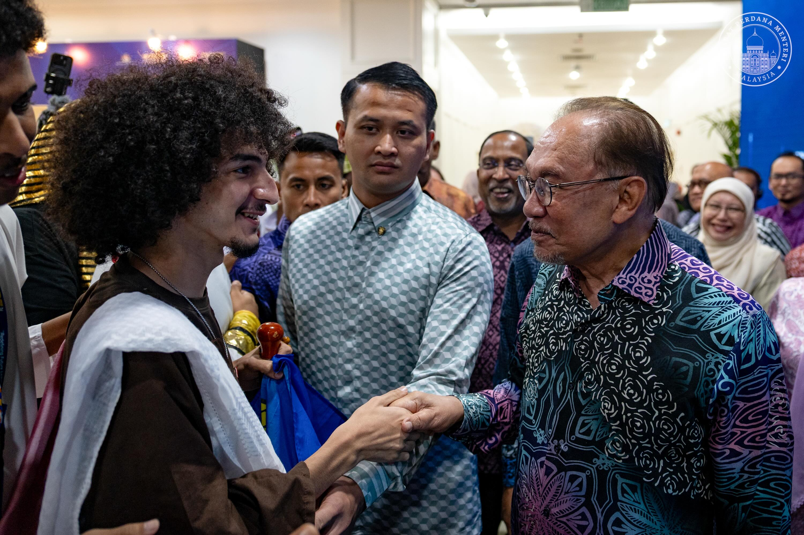

# Introduction

Hi! I'm Malek, a Software Engineering student at University of Malaya.
I'm half Egyptian, half Syrian, originally from Cairo, now based in PJ.
Outside class I work as a software engineer at Doctory and I'm President
of UMISA, the University of Malaya International Students Association.

- **Fun fact**: I love to dj every now and then but just as a hobby.
- **Course expectations**: To get better at working with legacy codebases
and picking up practices for keeping software maintainable long-term.

